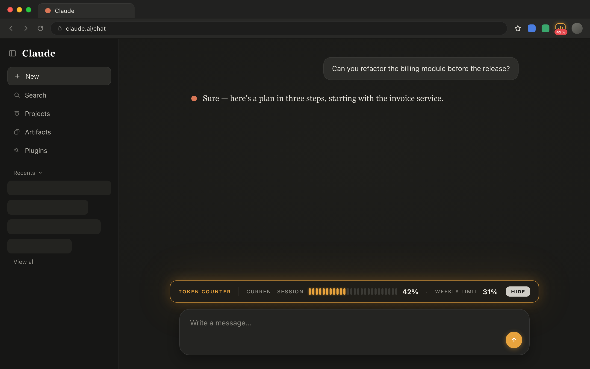
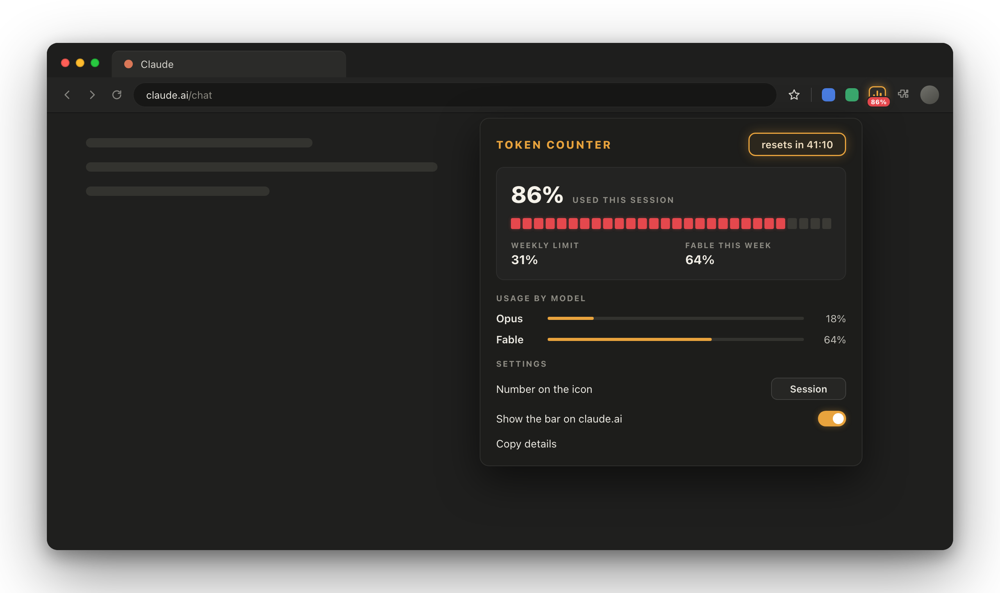
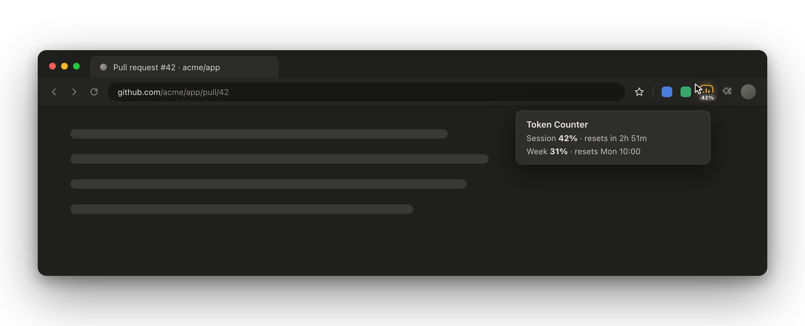

# Token Counter — free Chrome extension

*Pro and Max subscribers get a progress bar. This gives you the full picture.*

Token Counter is a Claude usage tracker that shows your Claude usage limits in real time — while there is still room to act, before "limit reached" and not after it. It reads the same on Free, Pro and Max: same panel, same numbers.

  

## What it tracks

Once installed, Token Counter sits in a small panel beside the chat, quiet until you look at it, and updates as you work. If you have been guessing what is left by feel, this replaces the guess. Three numbers, no settings to dig through, nothing to interpret:

- **Session usage** — how far you are into the current window, as a percentage. This is the number that decides when you run into the session limit mid-task, so it is the one worth a glance before you start anything long.
- **Weekly usage** — your rolling week-to-date consumption, so a heavy Monday cannot push you into the weekly limit by Thursday without warning; the week view is what turns a plan from a daily guess into a weekly budget.
- **Reset timer ⏱** — an exact countdown to the next reset, so "roughly this evening" becomes a time you can actually plan around.

  

A progress bar tells you a number is going down. That is all it was ever going to tell you. The point of a Claude token counter is the rest of the picture: how fast the bar moves and when what is left comes back. Both of those are things you can act on — pace tells you whether to finish the draft now or after dinner, and the countdown tells you whether "after dinner" is even an option. If you have ever searched for how to track Claude usage and found only API dashboards aimed at developers, this Claude token counter extension is the missing piece — a Claude token usage tracker built for the chat you already have open, reading what your plan is actually doing rather than what a pricing page promises.

The panel moves at the pace of the chat: percentages update while you work, and the reset timer counts down to the minute, so the picture is current whenever you look at it. Percentages instead of raw numbers is a deliberate choice — a percentage is readable at a glance, and it means the same thing on a quiet Tuesday and on a day when everything is on fire.

### What it doesn't track

The honest list, because a usage tool that overstates its scope is worse than none:

- No per-message counts and no conversation transcripts. You see percentages and time, not a ledger of what you wrote.
- No conversation content. Your prompts and answers stay yours; the panel never opens them and has no reason to.
- No API usage and no console billing. Developer-side spend tools are a different category — a Claude token counter for the API answers a different question than this one does.
- No upgrade advice, and no pretending otherwise: nothing raises your Claude usage limits except a bigger plan. What a panel can do is make sure those limits never arrive as a surprise. By the time the number is small, you already knew it would be.

## Who it's for

Chat subscribers on claude.ai — Free, Pro and Max plans. If your workday runs through the chat and "limit reached" is the sentence you fear, this panel was built for you. You do not need to read documentation to use it; if you can read a fuel gauge, you are already qualified.

Think of it as a Claude desktop usage tracker: it lives on your screen beside the conversation, not in a web dashboard you have to remember to open. That form factor is the difference between occasionally checking your usage and actually watching it move. A tracker you have to open is a tracker you will forget; one that is simply there, next to the conversation, gets consulted dozens of times a day without costing a second.

  

It earns its keep on the specific days: the long task started at 80 percent, the last day of the billing week, the send-it-now-or-after-the-reset call. Those decisions need a number, not a feeling. None of these are edge cases; on a plan you depend on, they are most days of the month.

**Not for API keys or Claude Code — made for chat subscribers.** If you need to track API billing or console spend, developer tools will serve you better. A Claude usage tracker for the chat watches plan limits, not invoices, and mixing up the two is how people end up with the wrong instrument for the question they had. Console dashboards, billing pages, per-request counters — all real tools, all built for the other audience.

## Quick Start

Two steps, about fifteen seconds:

1. **[Install from Chrome Web Store](https://chromewebstore.google.com/detail/token-counter/okmkcicheedpnmmfmhngagbofgjiodhj)** — free, one click, no account.
2. **Open claude.ai** — the Claude usage tracker extension appears on its own and starts showing usage from the session you are already in.

There is no step three. No first-run wizard, no fields to fill in, nothing to sign up for. Both steps happen once; there is nothing to repeat and nothing to maintain. If you keep the tab pinned — most subscribers do — the panel becomes part of the page, like the input box. And if it ever shows stale values, reload the tab once and the real numbers take their place.

## Privacy

Nothing leaves your browser. No account. No tracking.

Token Counter has no backend, no analytics and no sign-in. The usage numbers it shows are computed locally from the session you are already using — there is no server to send them to and no database for them to sit in. Uninstall the extension and every trace of it goes with it, settings included, because there are no settings.

That is not a policy ambition; it is an architecture fact. With nothing to send and nowhere to send it, privacy stops being a promise and becomes arithmetic. The people who wrote this extension use it themselves, on their own plans, and would notice anything that talked to the network.

The short version above is also the long version. The full privacy policy says the same thing in more words, for anyone who wants the details in writing.

## Links

- **Install** — [Chrome Web Store](https://chromewebstore.google.com/detail/token-counter/okmkcicheedpnmmfmhngagbofgjiodhj): free, one click, no account.
- **Privacy** — [what is and is not collected](https://pinwisp.com/token-counter/privacy/)
- **More free tools** — [pinwisp.com](https://pinwisp.com), other small and honest utilities from the same bench.

If Token Counter has saved you a cutoff mid-task, a short review on the store page helps the next subscriber find it faster than any store search does.
